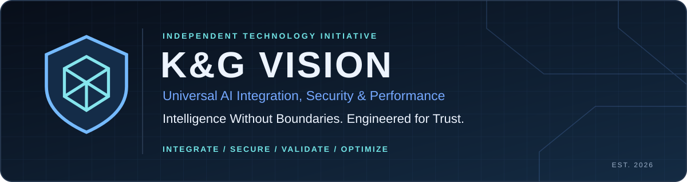

# K&G Vision

<!-- kg-personal-portfolio-v1 -->

**Idealizador / Creator:** [Kaio Gabriel da Silva — KG Professional Portfolio 1.0](https://kgasil.github.io/portfolio/) · [GitHub](https://github.com/Kgasil) · [LinkedIn](https://www.linkedin.com/in/kaio-gabriel-da-silva). Portfólio pessoal independente do projeto / Personal portfolio separate from this project.

<!-- kg-current-training -->
**Formação e trajetória do idealizador / Creator's education and experience:** [Currículo público atualizado / Updated public résumé](https://kgasil.github.io/portfolio/resume.html) · [Portfólio / Portfolio](https://kgasil.github.io/portfolio/). A formação pessoal é independente dos produtos e materiais do projeto / Personal training is independent of project products and materials.

**Intelligence Without Boundaries. Engineered for Trust.**

[Website](https://kgasil.github.io/) · [English](#english) · [Português](#português)

> **Marco 1.0 do ecossistema / Ecosystem milestone 1.0 — 25/11/2026.** Cinco projetos com entregas públicas distintas: conhecimento, ciência e inovação, engenharia de IA, produtividade e inteligência empresarial. / Five projects with distinct public deliverables: knowledge, science and innovation, AI engineering, productivity and business intelligence. See component versions below / Consulte as versões de cada componente abaixo.

> **Marco 01 — GRAAL (26/11/2026).** Rubedo integra o ecossistema como quinta frente; o registro anterior permanece preservado. / Rubedo joins as the fifth initiative; previous records are preserved.

**Papel no ecossistema / Ecosystem role:** Hoje, os projetos são desenvolvidos individualmente. A visão de longo prazo é a de frentes especializadas com autonomia e missões complementares, coordenadas pela K&G Vision. / Today, the projects are developed individually. The long-term vision is specialized initiatives with autonomy and complementary missions, coordinated by K&G Vision.

## GRAAL — metodologia empresarial / business methodology

**Aprender · Construir · Proteger · Simplificar · Evoluir** / **Learn · Build · Protect · Simplify · Evolve**

A K&G Vision propõe uma abordagem de imersão operacional: compreender o negócio, construir confiança e identificar oportunidades de melhoria antes de propor soluções. / K&G Vision proposes an operational immersion approach: understand the business, build trust and identify improvement opportunities before proposing solutions.

| Pilar / Pillar | Aplicação / Application | Projeto / Project |
| --- | --- | --- |
| Aprender / Learn | Conhecer o negócio e seus desafios / Understand the business and its challenges | [Genesis](https://kgasil.github.io/genesis/) |
| Construir / Build | Pesquisa, engenharia e soluções adequadas / Research, engineering and context-appropriate solutions | [Rubedo](https://kgasil.github.io/rubedo/) |
| Proteger / Protect | Segurança, privacidade e governança / Security, privacy and governance | [Argus](https://kgasil.github.io/argus/) |
| Simplificar / Simplify | Processos eficientes e automação / Efficient processes and automation | [Aeris](https://kgasil.github.io/aeris/) |
| Evoluir / Evolve | Indicadores, resultados e melhoria contínua / Metrics, results and continuous improvement | [Lilium](https://kgasil.github.io/lilium/) |

**Possibilidades de colaboração / Collaboration opportunities:** operações e processos, dados e BI, automação e integrações, inteligência artificial, segurança e governança / operations and processes, data and BI, automation and integrations, AI, security and governance.

A iniciativa permanece independente, ainda não constituída como empresa. A prestação de serviços, os acessos e o escopo dependem de formalização, enquadramento adequado e autorização. Os projetos públicos são demonstrações e pesquisa, não auditorias certificadas nem produtos de produção. Referências empresariais somente com autorização. / The initiative remains independent, not yet incorporated. Services, access and scope require formal agreement, legal eligibility and authorization. Public projects are demonstrations and research, not certified audits or production products. Business references require permission.

[Metodologia / Methodology](https://kgasil.github.io/#graal) · [Soluções / Solutions](https://kgasil.github.io/#solucoes) · [Parcerias / Partnerships](https://kgasil.github.io/#contato)

## English

K&G Vision is an independent technology initiative with a clear ambition: turn knowledge into practical technology, engineer AI for trust, simplify everyday work and empower business growth. Our long-term research direction spans vendor-neutral AI integration, cybersecurity, AI assurance and performance. The initiative is in development and is not an incorporated company; potential collaborations are subject to formal agreement and legal eligibility.

| Project | Purpose | Status |
| --- | --- | --- |
| [Project Genesis](https://github.com/Kgasil/genesis) | Independent study collection: 75 private PDFs, 60 thematic volumes and 10 integrated guides | [Public library](https://kgasil.github.io/genesis/biblioteca.html): 1.0 editorial milestone; 11 reading areas, 22 optional reading folders, 11 mini labs and 11 challenges; no courses or certificates · [Genesis Mini](https://kgasil.github.io/genesis/mini/) |
| [Project Rubedo](https://github.com/Kgasil/rubedo) | Applied science, simulation and computational engineering | [Public Lab 1.0](https://kgasil.github.io/rubedo/), milestone 01 · [Mini and installation](https://kgasil.github.io/rubedo/#instalar) |
| [Project Argus](https://github.com/Kgasil/argus) | Vendor-neutral AI integration, security, assurance and performance research | 1.0 public research milestone; technical baseline V10.2; [Argus Mini](https://kgasil.github.io/argus/mini/) complementary sample |
| [Project Aeris](https://github.com/Kgasil/aeris) | Lightweight, modular desktop and browser productivity tools | Desktop 1.1.0 RC1 public experimental preview; Extension 1.0.0 available for free manual installation |
| [Project Lilium](https://github.com/Kgasil/lilium) | Business intelligence, reporting and strategic automation | Web Lab 1.0; Desktop v0.14.0 controlled preview; Mini v0.1.1 GitHub-only |

**Learn · Build · Protect · Simplify · Evolve**

This repository hosts the provisional institutional website. The technical laboratory now lives at [Project Argus](https://github.com/Kgasil/argus). Current demonstrations are educational prototypes, not production products or independent security audits.

## Português

A K&G Vision é uma iniciativa tecnológica independente em desenvolvimento, ainda não constituída como empresa. Nosso propósito é conectar conhecimento científico, engenharia responsável e tecnologia útil. Nosso direcionamento de longo prazo inclui integração de IA, cibersegurança, avaliação de confiabilidade de IA e desempenho, sem dependência de um fornecedor. São objetivos de pesquisa e áreas propostas de colaboração, sujeitas à formalização e ao enquadramento adequado.

| Projeto | Propósito | Situação |
| --- | --- | --- |
| [Project Genesis](https://github.com/Kgasil/genesis) | Acervo independente: 75 PDFs privados, 60 volumes temáticos e 10 guias integrados | [Biblioteca pública](https://kgasil.github.io/genesis/biblioteca.html): 11 áreas, 22 pastas de leitura opcionais, 11 mini laboratórios e 11 desafios; sem cursos ou certificados · [Genesis Mini](https://kgasil.github.io/genesis/mini/) |
| [Project Rubedo](https://github.com/Kgasil/rubedo) | Pesquisa aplicada, simulação e engenharia computacional | [Public Lab 1.0](https://kgasil.github.io/rubedo/), Marco 01 · [Mini e instalação](https://kgasil.github.io/rubedo/#instalar) |
| [Project Argus](https://github.com/Kgasil/argus) | Pesquisa em integração, segurança, avaliação e desempenho de IA | Marco 1.0 do laboratório público; base técnica V10.2; [Argus Mini](https://kgasil.github.io/argus/mini/) amostra complementar |
| [Project Aeris](https://github.com/Kgasil/aeris) | Ferramentas leves e modulares para produtividade | Desktop 1.1.0 RC1 em prévia pública experimental; Extensão 1.0.0 disponível para instalação manual gratuita |
| [Project Lilium](https://github.com/Kgasil/lilium) | Inteligência empresarial, relatórios e automação estratégica | Web Lab 1.0; Desktop v0.14.0 em prévia; Mini v0.1.1 pelo GitHub |

**Aprender · Construir · Proteger · Simplificar · Evoluir**

O site institucional está em construção. Os 75 PDFs completos e materiais internos do Genesis não fazem parte deste repositório. O acesso ao acervo é solicitado diretamente ao idealizador pelo [LinkedIn](https://www.linkedin.com/in/kaio-gabriel-da-silva). As amostras públicas estão na biblioteca do Genesis. O laboratório técnico permanece em [Project Argus](https://kgasil.github.io/argus/).

## GRAAL — Ecosystem / Ecossistema · Marco 01

| Project | Website | Repository | Current stage / Etapa atual |
| --- | --- | --- | --- |
| K&G Vision | [Institutional](https://kgasil.github.io/) | [Source](https://github.com/Kgasil/kgasil.github.io) | Independent initiative / Iniciativa independente |
| Project Genesis | [Wisdom & Application / Sabedoria e Aplicação](https://kgasil.github.io/genesis/) | [Source](https://github.com/Kgasil/genesis) | **1.0 — Editorial & Library / Acervo e biblioteca.** 75 private study PDFs; [public interactive library](https://kgasil.github.io/genesis/biblioteca.html) / 75 PDFs privados; biblioteca pública interativa, sem cursos ou certificados. · [Genesis Mini — complemento gratuito](https://kgasil.github.io/genesis/mini/) · [Instalar extensão / Install extension](https://kgasil.github.io/genesis/#instalar-extensao) |
| Project Rubedo | [Science & Innovation / Ciência e Inovação](https://kgasil.github.io/rubedo/) | [Source](https://github.com/Kgasil/rubedo) | **Marco 01 — Public Lab 1.0.** [Research Workspace 1.0.1](https://kgasil.github.io/rubedo/research/) · [Mini Lab 1.0.1](https://kgasil.github.io/rubedo/mini/) · [Instalação manual / Manual installation](https://kgasil.github.io/rubedo/#instalar); experimental, no store distribution. |
| Project Argus | [Security & Development / Segurança e Desenvolvimento](https://kgasil.github.io/argus/) | [Source](https://github.com/Kgasil/argus) | **1.0 — Public Research Lab / Laboratório público.** Technical baseline V10.2; local demonstrations / Base técnica V10.2; demonstrações locais, não serviços de produção. [Argus Mini — amostra complementar / complementary sample](https://kgasil.github.io/argus/mini/), v0.1.0; original milestone unchanged / marco original preservado. · [Instalar extensão / Install extension](https://kgasil.github.io/argus/#instalar-extensao) |
| Project Aeris | [Efficiency & Simplicity / Eficiência e Simplicidade](https://kgasil.github.io/aeris/) | [Source](https://github.com/Kgasil/aeris) | **1.0 — Extension 1.0.0; Desktop 1.1.0 RC1.** Public experimental preview, not stable / Prévia pública experimental, não estável. [Desktop e extensão — instalação, avisos e evidências / installation, warnings and evidence](https://kgasil.github.io/aeris/#aeris-ai-setup) |
| Project Lilium | [Strategy & Evolution / Estratégia e Evolução](https://kgasil.github.io/lilium/) | [Source](https://github.com/Kgasil/lilium) | **1.0 — Web Lab.** Public demo / demonstração pública; Desktop v0.14.0 controlled preview / prévia controlada; [Mini v0.1.1](https://github.com/Kgasil/lilium/tree/main/extension) experimental. |

**Version note / Nota de versão:** 1.0 identifies the first completed public-facing project milestone of the ecosystem, not a uniform software release tag. Genesis is an editorial milestone; Argus retains technical baseline V10.2; Aeris 1.0.0 applies to Extension; Lilium 1.0 applies to Web Lab. / 1.0 identifica o primeiro marco público do ecossistema, não uma tag de software uniforme. Genesis é um marco editorial; Argus mantém a base V10.2; Aeris 1.0.0 refere-se à extensão; Lilium 1.0 refere-se ao Web Lab. Desktop previews are not stable releases / Prévias Desktop não são versões estáveis.

**Learn · Build · Protect · Simplify · Evolve / Aprender · Construir · Proteger · Simplificar · Evoluir**

## Website

- `index.html`: responsive institutional website with GRAAL, proposed business solutions, project ecosystem and partnership contact, PT-BR / EN.
- `assets/kg-symbol.svg`: institutional shield with five project colors and a white center.
- `assets/brand-banner.svg`: institutional banner.

Open `index.html` in a browser to preview locally. No build or backend is required.

The previous technical website is preserved in Git history and in the dedicated Project Argus repository. The original pre-migration HTML is at [this revision](https://github.com/Kgasil/kgasil.github.io/blob/eccfefbea8abebd5e9ae537ee2e7a9beca6c4829/index.html).

Contact: [GitHub](https://github.com/Kgasil) · [LinkedIn](https://www.linkedin.com/in/kaio-gabriel-da-silva)

## Identidade K&G Vision / K&G Vision identity

[Versão vertical / Vertical lockup](https://github.com/Kgasil/kgasil.github.io/blob/main/assets/brand-stacked.svg) · [Escudo / Shield](https://github.com/Kgasil/kgasil.github.io/blob/main/assets/kg-symbol.svg)

Official visual lockup: **K&G** above **Vision**; individual project symbols are retained. / Assinatura visual oficial: **K&G** acima de **Vision**, mantendo os símbolos individuais dos projetos.

**Genesis (purple) · Rubedo (orange/gold) · Argus (blue) · Aeris (green) · Lilium (rose)**

O escudo preserva as quatro cores laterais e o núcleo branco; Rubedo ocupa apenas as pontas centrais superior (laranja) e inferior (dourado). / The shield preserves the four side colors and white core; Rubedo occupies only the upper (orange) and lower (gold) central tips.

[Lilium Interactive Lab / Laboratório interativo](https://kgasil.github.io/lilium/#lab) · [Insights CSV demo](https://kgasil.github.io/lilium/demo.html) — browser-based synthetic exercises; no connected AI or commercial offering.

**Lilium Mini v0.1.1 — GitHub-only / exclusivamente pelo GitHub:** [Installation tutorial / Tutorial de instalação](https://github.com/Kgasil/lilium/tree/main/extension) · Chrome & Edge, manual installation with synthetic data / instalação manual com dados fictícios. Not published in extension stores / não publicado nas lojas.

**25 NOV 2026 — Lilium Web Lab 1.0:** [Comunicado / Announcement](https://github.com/Kgasil/lilium/blob/main/docs/web-lab-v1.0.md) · Public browser demonstrations / Demonstrações públicas no navegador. Desktop v0.14.0 remains a controlled preview / continua em prévia controlada.

**Aeris Extension 1.0.0** — 16 ferramentas, 50 testes automatizados aprovados; instalação manual disponível pelo GitHub. / 16 tools, 50 automated tests passed; manual installation available on GitHub. [Instalação / Installation](https://kgasil.github.io/aeris/extension-preview.html) · [Notas / Release notes](https://github.com/Kgasil/aeris/blob/main/release/extension-1.0.0-notes.md).

 **GRAAL · Marco 01** — identidade integrada / integrated identity.

**GRAAL — Construir / Build (Rubedo):** [Rubedo Research Workspace](https://kgasil.github.io/rubedo/research/) · [Precisão / Precision (R06)](https://kgasil.github.io/rubedo/research/#precisao) · [Monte Carlo (R07)](https://kgasil.github.io/rubedo/research/#monte-carlo). Modelos experimentais; CI de integridade e interface registrada em 27/11/2026 ([evidência / evidence](https://github.com/Kgasil/rubedo/actions/runs/46007461543)), sem validação científica ou industrial. / Experimental models; package and interface CI recorded, no scientific or industrial validation.

**Rubedo — edição 1.0.1 / 1.0.1 edition:** [Research Workspace 1.0.1](https://kgasil.github.io/rubedo/research/) · [Mini Lab 1.0.1](https://kgasil.github.io/rubedo/mini/) · [Mini Extension 1.0.1 — instalação manual / manual installation](https://kgasil.github.io/rubedo/#instalar). Edição experimental / Experimental edition.

## GRAAL — auditoria contínua dos sites / continuous website audit

[Auditoria automatizada / Automated audit](https://github.com/Kgasil/kgasil.github.io/actions/workflows/graal-web-audit.yml) · [Escopo e evidências / Scope and evidence](validation/web/README.md). Verificação diária de navegação, links, versões, integridade dos pacotes rastreados e responsividade em navegadores; não substitui análise antimalware. / Daily navigation, link, version, tracked package integrity and browser layout checks; not a substitute for malware analysis.

## Central de distribuição / Distribution center

[Versões, canais oficiais e segurança / Versions, official channels and security](https://kgasil.github.io/distribuicao.html) · [Critérios de liberação / Release criteria](validation/distribution/README.md).

**[Política de assinatura de código / Code signing policy](validation/signing/README.md)** · [Evidências / Evidence](https://github.com/Kgasil/kgasil.github.io/actions/workflows/graal-signing.yml). Desenvolvimento e procedência web; não equivale a assinatura pública dos instaladores.

<!-- graal-governance-v1:start -->
## Governança GRAAL / GRAAL governance

[**Catálogo central de componentes, versões, segurança e maturidade / Central catalog of components, versions, security and maturity**](https://github.com/Kgasil/kgasil.github.io/blob/main/docs/graal-catalog.md) · [Central de distribuição / Distribution center](https://kgasil.github.io/distribuicao.html)

O catálogo é a referência institucional para o estado atual; registros históricos e avisos específicos deste repositório permanecem aplicáveis. Em caso de divergência, prevalece o estado mais restritivo. / The catalog is the institutional reference for current status; this repository's historical records and specific notices remain applicable. If records disagree, the most restrictive state prevails.
<!-- graal-governance-v1:end -->

## Colaboração empresarial / Business collaboration

[Catálogo de serviços e modelo de colaboração GRAAL / GRAAL service catalog and collaboration model](docs/commercial-model-stage-05.md). Proposta de atuação em dados, BI, processos, automação, IA, segurança e governança; contratação condicionada a formalização e escopo. Projetos públicos permanecem gratuitos. / Proposed services in data, BI, processes, automation, AI, security and governance; engagements subject to formalization and scope. Public projects remain free.

[Governança empresarial / Business governance](docs/business-governance-stage-07.md) — princípios públicos, responsabilidades propostas e critérios de formalização / public principles, proposed responsibilities and formalization gates.

[Relatório de homologação institucional / Institutional acceptance report](docs/institutional-acceptance-stage-08.md) — fechamento do primeiro ciclo, evidências, limites e plano 30/60/90 dias; não constitui certificação nem aprovação integral de distribuição / first-cycle closure, evidence, limits and 30/60/90-day plan; not certification or full distribution approval.

[Relatório final do segundo ciclo / Cycle 02 final report](docs/technical-excellence-cycle-02-step-08.md) — evidências comparáveis, limites e prioridades; sem certificação ou aprovação integral de distribuição / comparable evidence, limitations and priorities; no certification or full release approval.
